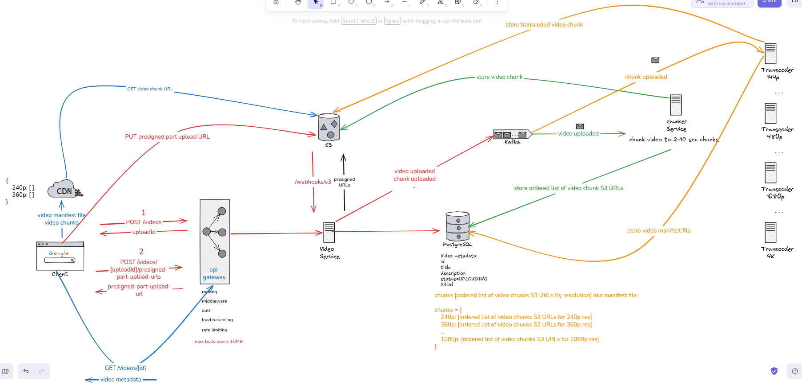
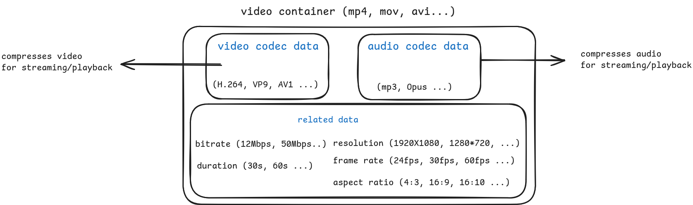

# YouTube system design

I'm learning system design by doing. YouTube is a video sharing platform where users upload, view and interact with
video content. The YouTube system design was inspired
by [Hello Interview](https://www.youtube.com/watch?v=IUrQ5_g3XKs),
the following is an implementation using Spring boot 4 and Next.js 16.

Check out the [YouTube Next.js Client](https://github.com/WissemBoujlida/youtube-clone).

## Functional Requirements

What the system must do:

1. Users should be able to upload videos *
2. Users should be able to watch/stream videos *
3. Users should be able to interact with video content (likes, subscriptions, playlists, comments ...)

## Scale

- 1M uploads/day
- 100M DAU (Daily Active Users)
- Max video size of 256GB

## Non-Functional Requirements

System characteristics:

1. CAP theorem: Availability >> Consistency for video uploads
2. Scalability to scale to 1M uploads/day and 100M DAU (views)
3. Support multipart uploading/streaming for large videos (256GB)
4. Low latency streaming (<500ms) in low bandwidth

## Core Entities

- Video metadata

```text
    id
    title
    description
    duration
    uploadedAt
    userId
    s3Url
```

- User

```text
    id
    username
    email
    videos[]
```

- raw Video file (raw bytes) are stored in object store (S3)

## API

// upload video

`POST` /videos

```Text
{
    videoMetadata
}
```

// watch a video

`GET` /videos/{videoId}

```Text
{
    videoMetadata
}
```

## High Level Design

Satisfy the Functional-Requirements

upload / stream videos directly from S3 using pre-signed URLs.

### Upload Video

Multipart upload a video directly to S3 using presigned part upload URLs. Part size = 10MB (max allowed body size for
most API gateways): check out [File upload Service](https://github.com/WissemBoujlida/file-upload-service) for more
details on how multipart upload works

1. client requests to start a video multipart upload
2. server authenticates & authorizes client
3. server stores video metadata
4. client chunks video into multiple smaller parts (part size = 10MB)
5. client requests presigned part upload URLs
6. client streams those parts directly to S3 using presigned part upload URLs.
7. S3 notifies server when video upload is complete using webhooks.
8. server publishes a "video uploaded" event to message broker.
9. subscribers consumes "video uploaded" event to start long-running background jobs: (eg: chunking, transcoding,
   subtitle generation, thumbnail generation ...)

### Watch/Stream Video

1. client requests a video by id
2. server returns video metadata
3. client requests each video chunk in the ordered list of video chunks S3 URLs directly from S3 in ~1-3 sec increments:

In practice, the client fetches **in parallel**:

- video metadata: GET /video/{id} ← description, title, ....
- video manifest file from CDN

## Deep Dives

Satisfy Non-Functional Requirements

### Support streaming for large videos

1. Video chunker service subscribes to "video uploaded" event
2. Video chunker worker chunks video to 2-10 seconds chunks
3. Store video chunks to S3
4. Update video metadata: store list of ordered video chunk S3 URLS

Chunking allows client to stream video chunks from S3, and so client can quickly start streaming first few seconds from
video ⇒ Low latency

### Low latency streaming (<500ms) in low bandwidth

ensure low latency in low bandwidth:

1. transcode each video chunk to multiple bitrates/resolutions (in parallel)
2. stream optimal bitrate/resolution to client
3. Store transcoded video chunks to S3
4. Update video metadata: store list of ordered video chunk S3 URLS per resolution (manifest file)

#### Adaptive bitrate

What if user starts watching a video at 4K at home (user has reliable fast internet at home), then continues watching
outside on his phone (3G), or maybe user simply has unstable Internet connection ⇒ adaptive bitrate

adaptive bitrate = client periodically reassess Network speed to adaptively fetch the subsequent chunk

1. check network speed
2. fetch and play N chunks in 4K
3. periodically reassess Network speed
4. fetch and play M chunks in 1080P

#### CDN

client fetches each video chunk from S3 ⇒ latency issues may arise for requests from different geographic locations ⇒
CDN. the CDN caches popular video chunks and popular video manifest files for each region.

### availability >> consistency for video uploads

availability >> consistency for video uploads: we prioritize availability: users can see other videos until new video
is ready (async processing is complete).

### scalability: scale to 1M uploads/day; 100M views (DAU)

1. horizontally scale video service (stateless) = scalable horizontally to any number of instances as needed, api
   gateway serves as a load balancer
2. S3: "infinitely" scalable
3. video metadata table (PostgreSQL)
    - 1M writes/day * 365 * 1KB = 0.35TB/year<br>
    - if you want to do sharding (eg: dynamoDB): shard key = videoId, sort key = uploadedAt
4. video chunking & transcoding services are stateless: scale horizontally ideally dynamically (kubernetes) & usually
   scale by RAM/CPU usage threshold as needed

### YouTube system design



## Keynotes

### Streaming protocols

everything from: video chunking, transcoding, adaptive bitrate streaming, storing and fetching manifest file, video
chunks in S3 / CDN is implemented by streaming protocols:

- HLS (apple)
- DASH (open source)

### Video container format

a video container format: (eg: mp4, mov(Apple), avi (legacy MS) ...) packages video, audio, and related data in a file.



### resolution

- video resolution is the number of pixels in each frame (1920X1080 = Matrix(1920, 1080))
- resolution ↑ ⇒ level detail ↑ ⇒ sharper image

### bitrate

- bitrate is the amount of data per second used to update pixels in a frame: each pixel needs to be updated every frame.
  You need to 'tell' each pixel what color/brightness it needs to be.
- If the bitrate is high enough to update every single pixel for every frame, you'll get the best quality video;
  therefore a higher bitrate isn't going to make any difference.
- as you lower the bitrate ⇒ you have to make compromises to keep everything working i.e. compression ⇒ lower video
  quality

- e.g. at a lower bitrate, one form of compression could be:
    - imagine a row of 1080 pixels that gradually goes from black to white, each pixel getting slightly brighter as it
      goes along
    - the difference is so gradual, that you have to go 10 pixels along before there's a noticeable difference from pure
      black,
    - Rather than update every pixel individually with the slightly brighter color, make all those 10 pixels the same
      pure black

- e.g. at a lower bitrate, another form of compression could be:
    - only update the pixels that's actually changed from the last frame: e.g. if the video is a person talking in front
      of a static background, there's no point updating the background every frame